<div align="center">


# Udyam Digital

**Turning every SMB lead into an activated Airtel Business customer.**
Discover a bundle, get one clear price, verify, sign, pay and track — on a phone, in Hindi, Marathi, Tamil or English.

[](https://udyam-digital-kappa.vercel.app)
[](https://udyam-digital-kappa.vercel.app/ops)
[](https://udyam-digital-kappa.vercel.app/demo.mp4)

       

*YTL Hackathon 2026 · Enterprise Track A · Airtel SYNC — Team BitStorm (Gaurang Garg · Abhi Garg)*

</div>

---

## Watch the demo

<div align="center">

<a href="https://udyam-digital-kappa.vercel.app/demo.mp4">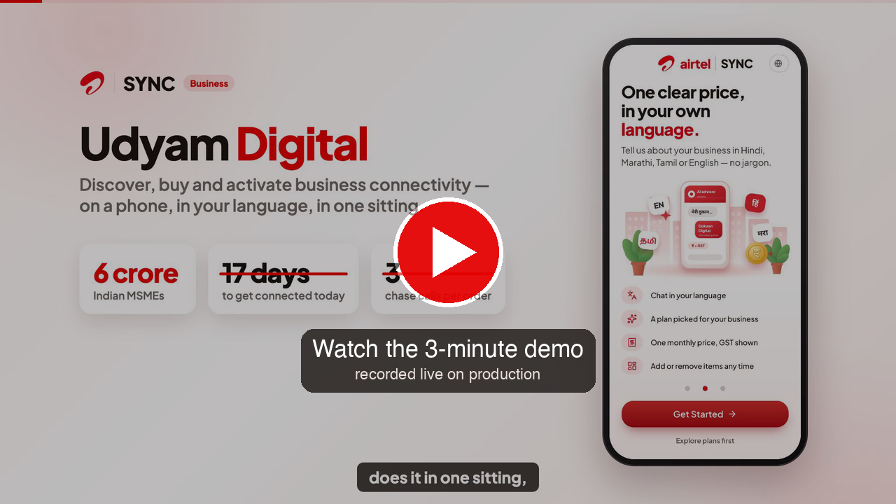</a>

**[▶ Play the 3-minute demo](https://udyam-digital-kappa.vercel.app/demo.mp4)** · [MP4 in the repo](public/demo.mp4) · [Google Drive](https://drive.google.com/drive/u/1/folders/1kKCy7cLnNn8draOn5uVk0nRQHl97aGQG)

<sub>Recorded end-to-end on production: real SMS OTP, DigiLocker, SMS e-sign, Razorpay test mode (fail → retry → success), WhatsApp updates and the ops console.</sub>

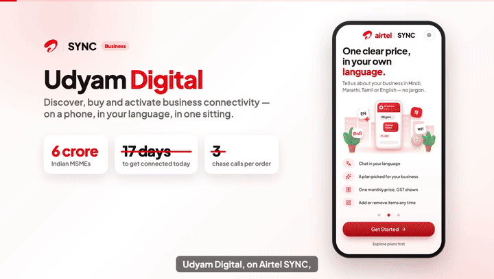

<sub>Highlights preview</sub>

</div>

---

## Submission at a glance

| | Deliverable | Link |
|---|---|---|
| 🎥 | **Demo video (3 min)** — shot end-to-end on production with a real phone, DigiLocker, SMS e-sign, Razorpay test mode and WhatsApp | [Play the video](https://udyam-digital-kappa.vercel.app/demo.mp4) · [Google Drive](https://drive.google.com/drive/u/1/folders/1kKCy7cLnNn8draOn5uVk0nRQHl97aGQG) |
| 📱 | **Live prototype** — customer app (open on a phone, or tap *Try the demo, no sign-in needed*) | [udyam-digital-kappa.vercel.app](https://udyam-digital-kappa.vercel.app) |
| 🛠️ | **Ops console** — sales, KYC reviewers, partners (one click: *Demo Admin*) | [udyam-digital-kappa.vercel.app/ops](https://udyam-digital-kappa.vercel.app/ops) |
| 🏗️ | **Architecture diagram** — numbered, self-explaining | [PNG](docs/architecture.png) · [PDF](docs/solutionarchitecturediagram.pdf) · [notes](docs/ARCHITECTURE.md) |
| 🔒 | **Privacy & security note** (1 page) | [PDF](docs/privacy-security.pdf) · [text](docs/PRIVACY_AND_SECURITY.md) |
| 📊 | **Business case** (≤ 10 slides) | [Google Drive folder](https://drive.google.com/drive/u/1/folders/1kKCy7cLnNn8draOn5uVk0nRQHl97aGQG) |
| 💻 | **Code** | this repository |

---

## The problem, in numbers

Of **5,000** SMB leads in one quarter only **368** activated — **7.36%**, after **17.6 days**, at **₹15,053** per activation, with **~3** status-chasing calls per order.
The biggest leak is needs → quote (−56%), and **1,652 leads (33%)** were lost to friction a digital journey removes. The demand exists; the conversion mechanism doesn't.

**Udyam Digital** is that mechanism: an AI advisor that speaks the owner's language, a rules engine that owns every price and eligibility decision, registry-first KYC, OTP e-sign, payments with retry, a live tracker on WhatsApp — and an ops console where people step in only where they add value.

> **Rules decide, AI explains.** Eligibility, price, KYC verdicts and order state are deterministic, unit-tested code. Gemini only understands words, reads pages and writes the explanation — and every number it writes is checked against the engine.

---

## The product

<table>
<tr>
<td align="center">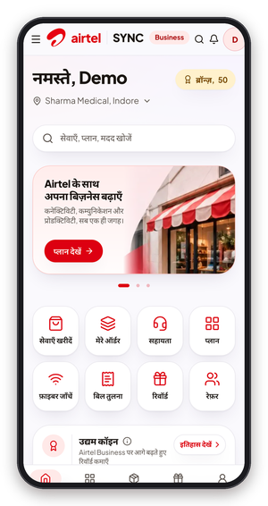<br/><b>4 languages</b><br/><sub>Hindi · Marathi · Tamil · English</sub></td>
<td align="center">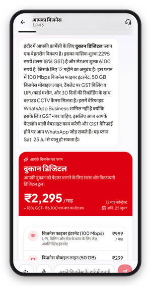<br/><b>AI advisor</b><br/><sub>asks only what's missing</sub></td>
<td align="center">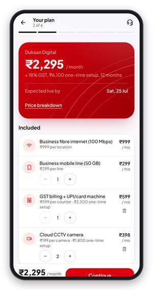<br/><b>One clear price</b><br/><sub>toggle add-ons, live re-price</sub></td>
<td align="center">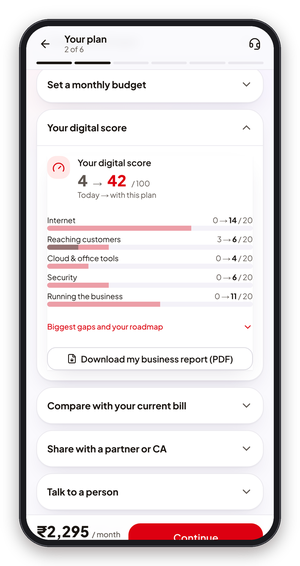<br/><b>Business analyzer</b><br/><sub>digital score + roadmap PDF</sub></td>
<td align="center">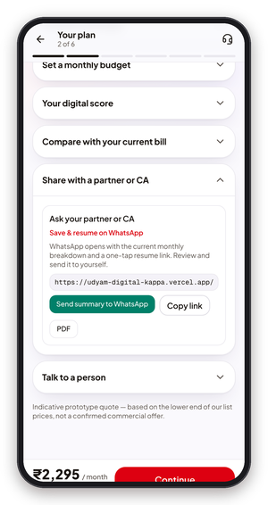<br/><b>Share with CA</b><br/><sub>live plan, no personal data</sub></td>
<td align="center">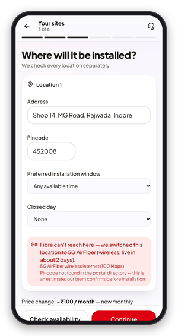<br/><b>Feasibility</b><br/><sub>no fibre → AirFiber</sub></td>
</tr>
<tr>
<td align="center">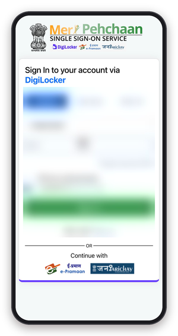<br/><b>DigiLocker</b><br/><sub>owner consents on gov screen</sub></td>
<td align="center">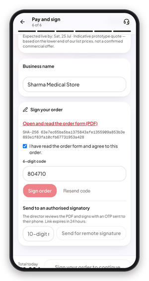<br/><b>SMS e-sign</b><br/><sub>OTP bound to the PDF hash</sub></td>
<td align="center">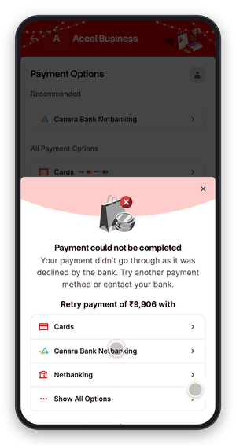<br/><b>Payment retry</b><br/><sub>Razorpay test · fail → retry</sub></td>
<td align="center">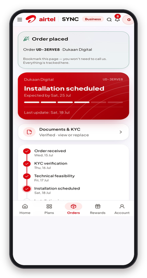<br/><b>Live tracker</b><br/><sub>self-booked install slot</sub></td>
<td align="center">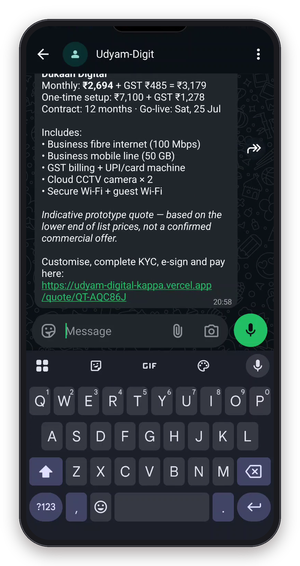<br/><b>WhatsApp advisor</b><br/><sub>same plan, in chat</sub></td>
<td align="center">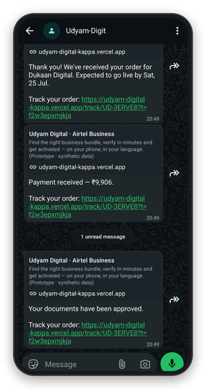<br/><b>WhatsApp updates</b><br/><sub>every step, no chase calls</sub></td>
</tr>
</table>

<sub>Real screens from the live prototype. DigiLocker personal data is blurred.</sub>

### Smart KYC — every planted problem in the sample set is caught

| Applicant | Planted problem | What the owner sees |
|---|---|---|
| K04 | Blurred GST certificate |  |
| K06 | GSTIN fails its mod-36 check digit | 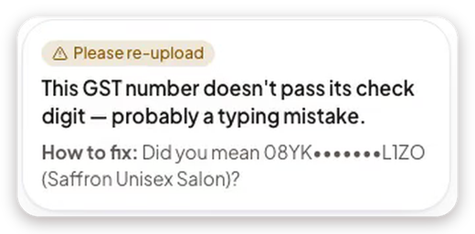 |
| K07 | Business name differs between documents |  |
| K11 | Address proof older than 90 days | 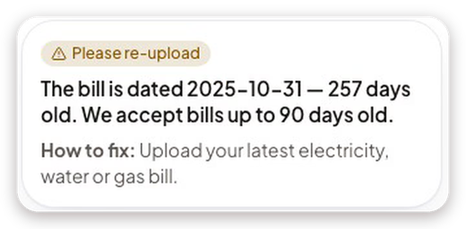 |
| K01 | GST registration cancelled → plan re-priced without GST products | 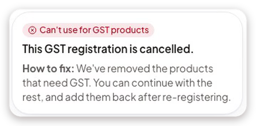 |

### Ops console — one place for sales, reviewers and partners

<p align="center">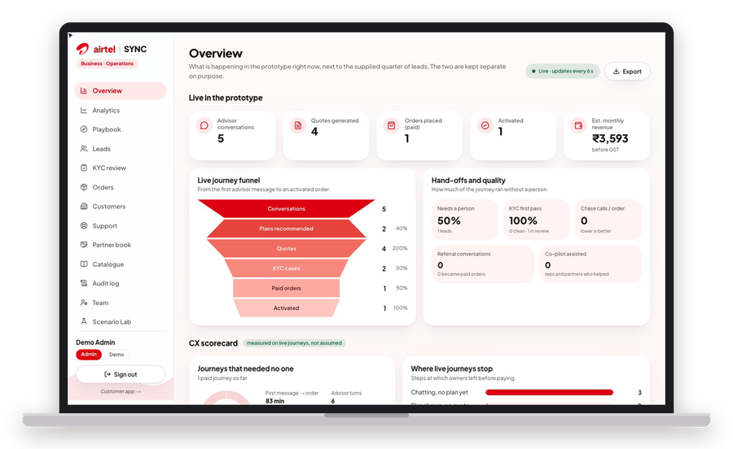</p>

<table>
<tr>
<td align="center">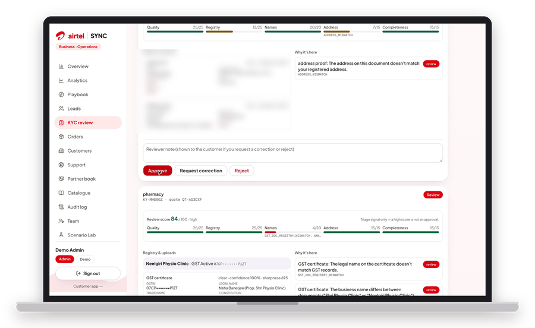<br/><b>KYC review</b> — score, reasons, approve</td>
<td align="center"><br/><b>Leads</b> — propensity score, next action</td>
<td align="center">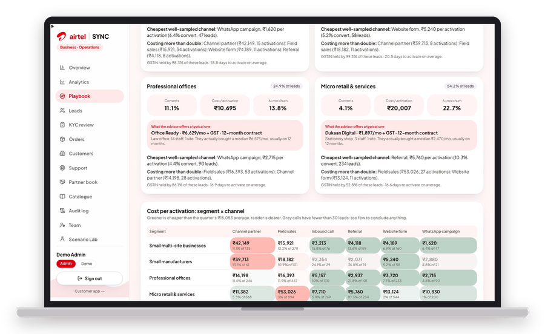<br/><b>Playbook</b> — who to target first</td>
</tr>
<tr>
<td align="center"><br/><b>Analytics</b> — funnel, CAC, churn, pilot targets</td>
<td align="center">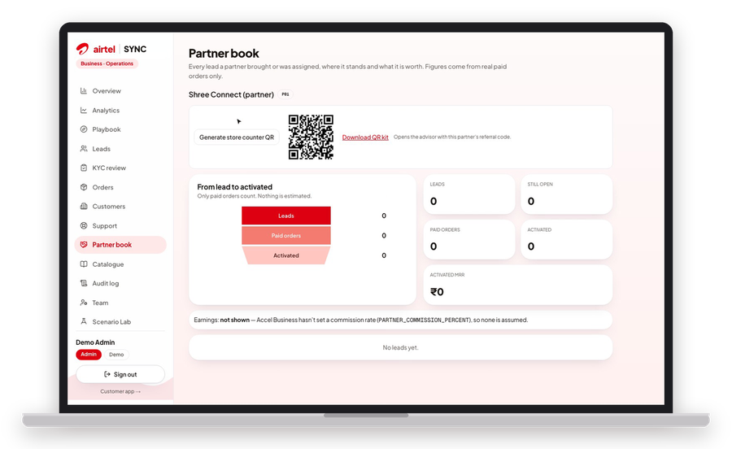<br/><b>Partner book</b> — store QR, attributed orders</td>
<td align="center">Insights are <b>computed</b> from the 5,000 leads and ranked by evidence — never hand-written. Every ops action is role-checked and audit-logged.</td>
</tr>
</table>

---

## How it answers the brief

| Brief | What we built | Try it |
|---|---|---|
| **Must-build 1 · GenAI advisor** (Hindi + regional + English) | Free-text understanding in 4 languages, asks only what's missing, explains the plan, answers what-ifs; the rules engine picks the bundle and every number is faithfulness-checked | `/advisor`, or WhatsApp |
| **Must-build 2 · Quote & checkout** | One transparent monthly price with GST and setup, toggleable add-ons, packages side by side, blocked items explain why, share link + PDF for a CA | Advisor → *Customise & buy* |
| **Must-build 3 · Smart KYC** | Explicit DPDP consent → GSTIN (mod-36 + status) & Udyam lookups → only missing documents (upload, DigiLocker, Aadhaar offline e-KYC, CA link) → Gemini reads → 20+ validators → verdict with a fix | KYC page → *Demo: try sample documents* (K01–K12) |
| **Must-build 4 · Order tracker** | Order state machine, self-booked install slot, WhatsApp/Telegram updates on every step — the same record ops advances | after payment, or `/ops/orders` |
| **Stretch · WhatsApp / voice** | Same advisor on WhatsApp (Meta Cloud API) and Telegram; voice input in the app | chat the WhatsApp number |
| **Stretch · back office + propensity** | Ops console: leads with propensity + win-back, KYC review, orders board, analytics, playbook, partner QR, scenario lab, audit | `/ops` → *Demo Admin* |

**What sets it apart**
- **The AI can't invent a price.** Any number in a reply that the engine didn't produce gets the reply dropped; if Gemini is down, the app says so instead of guessing.
- **Nothing is faked.** Real SMS OTP, real DigiLocker (licensed provider), real e-signature with a certificate, Razorpay with server-side signature checks, real WhatsApp — and a missing key makes a feature refuse honestly.
- **KYC that explains itself.** Registry first, then only what's missing; every failure names the reason and the fix.
- **Built for the field force, not against it.** Propensity-ranked leads, AI summaries, co-pilot credit for assisted sales, partner store QR.

---

## Architecture

<p align="center">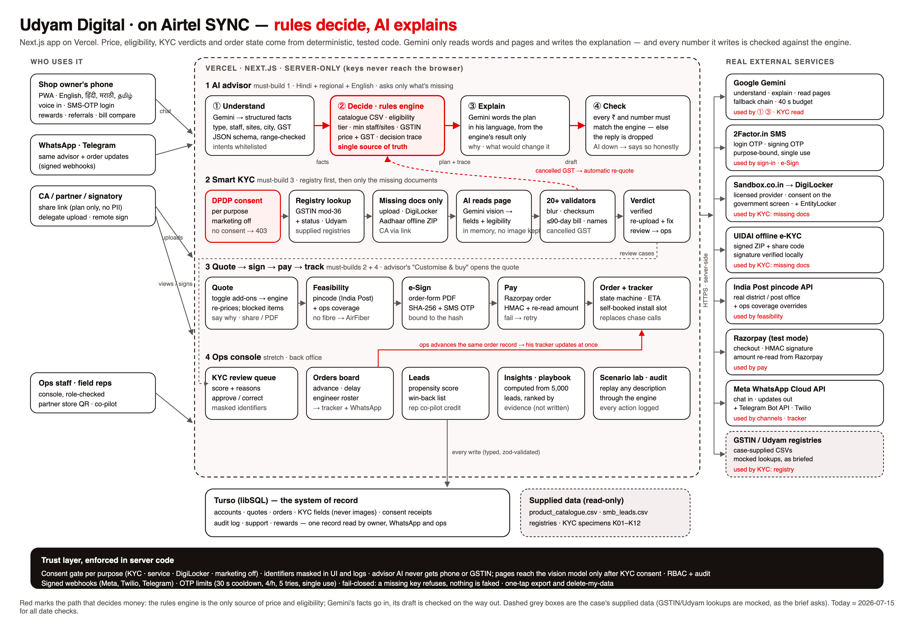</p>

Four lanes inside one server-only Next.js app on Vercel (Mumbai): **AI advisor** (understand → rules engine → explain → number check), **Smart KYC** (consent → registry → missing docs → AI reads → validators → verdict), **buy & track** (quote → feasibility → e-sign → pay → tracker) and the **ops console**. Turso (libSQL) is the one record read by the owner, WhatsApp and ops. Details: [`docs/ARCHITECTURE.md`](docs/ARCHITECTURE.md).

| Concern | Service |
|---|---|
| Understanding, explanations, document reading | Google Gemini (paid API, server-side, model fallback chain) |
| SMS OTP for login and signing | 2Factor.in |
| DigiLocker / EntityLocker | Sandbox.co.in licensed provider · UIDAI offline e-KYC verified locally |
| Fibre feasibility | India Post pincode API + ops coverage overrides |
| Payments | Razorpay (test mode), HMAC-verified, amount re-read server-side |
| Chat channels | Meta WhatsApp Cloud API · Telegram Bot API (Twilio fallback) |
| GSTIN / Udyam lookups | the case's supplied registries (mocked, as the brief asks) |

## Privacy & security

Consent before collection, enforced in code · registry first, only missing documents · uploaded files read in memory and never stored · identifiers masked in UI and logs · role-checked, audit-logged ops · signed webhooks · OTP limits · fail-closed services · one-tap export and delete-my-data. Full one-page note, including the honest list of gaps before production: [`docs/privacy-security.pdf`](docs/privacy-security.pdf).

---

## Run it

> **Evaluators:** `npm install && npm run build && npm start` works on a fresh clone with no cloud accounts (local database, auto-migrated). Vercel + Turso: see [`docs/DEPLOYMENT.md`](docs/DEPLOYMENT.md).

```bash
npm install
cp .env.example .env.local   # then fill in the keys you have (see the table below)
npm run dev                  # http://localhost:3000   (ops console: /ops)
npm run db:seed              # demo staff, engineer roster, + first admin if ADMIN_EMAIL/ADMIN_PASSWORD are set
npm run db:studio            # browse the database (schema: lib/db/schema.ts, migrations: ./drizzle)
```

| Key(s) in `.env.local` | Unlocks |
|---|---|
| `GEMINI_API_KEY` (paid tier recommended) | Free-form advisor in any language, document reading, bill reading |
| `TWOFACTOR_API_KEY` | Real SMS OTP for login and signing |
| `RAZORPAY_KEY_ID`, `NEXT_PUBLIC_RAZORPAY_KEY_ID`, `RAZORPAY_KEY_SECRET` | Test-mode payments (Netbanking → any bank → Success) |
| `TELEGRAM_BOT_TOKEN` (+ the generated `TELEGRAM_WEBHOOK_SECRET`) | Telegram bot |
| `META_WA_*` or `TWILIO_*` | WhatsApp |
| `PUBLIC_BASE_URL` | Links in chat/notifications and webhooks (`npm run tunnel` locally) — then `npm run setup:channels` |
| `SANDBOX_API_KEY`, `SANDBOX_API_SECRET` | DigiLocker + EntityLocker via a licensed provider (document fetch is a paid API); `DIGILOCKER_*` only if you hold API Setu credentials |
| `DATABASE_URL`, `DATABASE_AUTH_TOKEN` | Turso for a deployed site |

Without a key, that feature refuses honestly (the status panel says why); nothing is faked.

## Verify it

```bash
npm test                     # 270+ unit tests: rules engine, 5,000-lead backtest, KYC answer key, advisor conversation, channels
npm run typecheck && npm run build
npm run test:e2e             # 37 browser tests (journeys at phone size, guards, ops) — needs the dev server; BASE=… for another port
ALLOW_TEST_VERIFY=1 npm run dev   # then, in another terminal:
npm run check:journey        # live end-to-end API checks across the demo scenarios (test-only OTP/payment seams)
npm run check:ai             # real Gemini calls: extraction in 6 languages + faithfulness (+ `-- --ocr` for all 47 specimens)
```

## What to try (judges)

| Try | You'll see |
|---|---|
| *Try the demo* → Advisor, type in Hindi | One-message extraction, plan with decision trace, WhatsApp Business refused without GST — with an honest alternative |
| Quote → toggle add-ons, *Compare packages*, *Share with a partner or CA* | Instant re-price, blocked items explained, read-only live link + PDF with no personal data |
| Quote → *Your digital score* → *Download my business report* | Advisory 0–100 score before/after, roadmap, PDF report |
| Sites → pincode `452008` | India Post lookup; no fibre → AirFiber chosen automatically |
| KYC → *Demo: try sample documents* → K04 / K06 / K07 / K11 / K01 | Blur, wrong GSTIN, name mismatch, stale bill and cancelled GST caught, each with a fix |
| `/ops` → *Demo Admin* → KYC review → *Approve* | The customer's tracker updates at once |
| Chat: *"why do I need CCTV?"*, *"remove CCTV"*, *"make it 4 cameras"*, *"hindi mein batao"* | Grounded answers, engine-checked changes, language switch — web, WhatsApp, Telegram |
| `/ops/lab` | Paste any business → extracted facts, every rule applied, priced plan |
| Account → *Your data & privacy* | Download everything as JSON, or delete the account in one tap |

## How it's organised

```
app/                customer screens (/, /advisor, /quote, /order/[id]/{sites,consent,kyc,checkout}, /track, /account) and /ops/*
app/api/            advisor, quote, feasibility, consent, kyc, digilocker, orders, channels, ops/*, lab
lib/rules/          the engine: normalise · eligibility · pricing/GST/schedule · recommend · quote editing · counterfactuals
lib/kyc/            identifiers (mod-36 GSTIN, OCR repair) · match · 20+ validators · Gemini reader · Aadhaar offline e-KYC
lib/advisor/        orchestrator · Gemini understanding + grounded answers · faithfulness gate
lib/digilocker/     licensed-provider and direct OAuth flows
lib/store, lib/db   orders/tracker state machine · libSQL document store · leads, propensity, insights
data/               the supplied CSVs and KYC images (read-only)
tests/, e2e/        unit tests (Vitest) · browser tests (Playwright)
docs/               architecture · privacy & security · deployment · demo script · checklist
```

## Findings from the data (used in the product)
- 1,652 of 5,000 leads (33%) dropped for reasons a digital journey directly fixes → the **win-back** queue.
- Leads with a GSTIN convert at 9.6% vs 2.0% → the app shows what a GSTIN unlocks.
- 56 of 368 historical sales **violated the catalogue's own rules** and 22 activations used a **Cancelled/Suspended GSTIN**; historical bundles are therefore *not* ground truth for the engine.
- Chase calls correlate with churn (1 call → 6%, 5 → 28%); the app states correlation, never causation.

---

<div align="center">
<sub>All business records are synthetic (the case's dataset). Prices are indicative (catalogue minimum). A prototype built in the spirit of India's DPDP Act, 2023 — not a claim of legal certification.</sub><br/>
<sub><b>Team BitStorm</b> · Gaurang Garg · Abhi Garg</sub>
</div>
