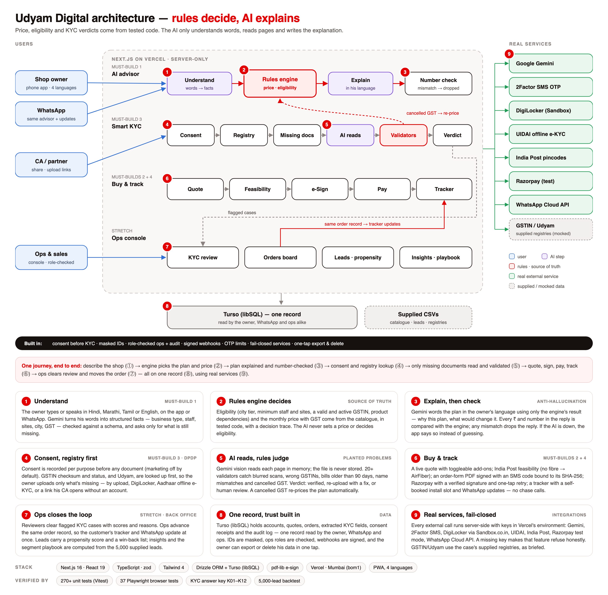

# Architecture — Udyam Digital

**One rule drives the design: _rules decide, AI explains._** Eligibility, price, KYC verdicts and order state come from deterministic,
unit-tested code. The language model (Gemini) turns the owner's words into structured facts and intents, explains the plan, and answers
questions — always from a context the code assembled, and every number it writes is checked against the engine's output.

Source: [`architecture.html`](architecture.html) (hand-drawn SVG) · print version: [`architecture.pdf`](architecture.pdf).

The diagram is self-explaining: numbered markers ①–⑨ match the nine notes printed under it (one customer journey, end to end).
Four lanes run inside one server-only Next.js app on Vercel: **(1) AI advisor** — understand → decide (rules engine) → explain → check;
**(2) Smart KYC** — consent → registry → missing docs only → AI reads page → validators → verdict; **(3) quote → feasibility → e-sign → pay →
order + tracker**; **(4) ops console** — KYC review, orders board, leads, computed insights, scenario lab. Turso (libSQL) is the one record
read by the owner, WhatsApp and ops.

## External services (every one fails closed: no key → it refuses, nothing is faked)
| Concern | Service | Code |
|---|---|---|
| Language understanding, explanations, Q&A, document reading | Google Gemini (per-model fallback chain; vision only on full-size models) | `lib/ai/gemini.ts`, `lib/advisor/llm.ts`, `lib/kyc/ocr.ts` |
| Phone OTP (login + signing) | 2Factor.in SMS | `lib/otp/flow.ts` |
| Payments | Razorpay (test mode): server order, HMAC signature + payment lookup | `lib/services/razorpay.ts` |
| e-Sign | Own: pdf-lib order form, SHA-256, OTP bound to the hash, certificate page | `lib/esign/pdf.ts` |
| Fibre feasibility | India Post pincode API (api.postalpincode.in) + ops coverage overrides | `lib/feasibility` |
| Scheduling | Own engineer roster + unique slot bookings | `lib/scheduling` |
| WhatsApp | Meta Cloud API (preferred) or Twilio | `lib/channels/{meta,twilio,whatsapp}.ts` |
| Telegram | Bot API with secret-token webhook | `lib/channels/telegram.ts` |
| DigiLocker / EntityLocker | Sandbox.co.in licensed provider (owner consents on the government screen); direct OAuth 2.0 + PKCE also supported | `lib/digilocker/{aggregator,client}.ts` |
| Aadhaar offline e-KYC | UIDAI signed ZIP + share code, signature verified locally | `lib/kyc/aadhaar.ts` |
| GSTIN / Udyam lookups | The case's supplied registries (the brief asks for mocked lookups; no free official API exists) | `lib/kyc/registry.ts` |

## Data flow (one journey)
1. Owner chats (web, WhatsApp or Telegram) → **Advisor** extracts facts and intent → asks only what's missing, or answers the question.
2. **Rules engine** returns the plan, exclusions with reasons, counterfactuals and a **decision trace**; the model never sets a price.
3. **Quote** edits go to the server; the engine re-prices and refuses invalid combinations. The owner can share a read-only live link.
4. **Feasibility** per site: India Post data, ops coverage first; a non-fibre site swaps to AirFiber only if the catalogue allows it.
5. **Consent** is recorded per purpose; every KYC call is refused without it.
6. **KYC**: registry first, then only the missing documents; failures carry a reason and a fix; cancelled GST → automatic re-quote.
7. **Sign** (PDF + SMS OTP) → **Pay** (Razorpay) → **Order** → **Tracker**, which reads the same record that **Ops** advances; the owner
   picks an installation slot; every update is pushed to WhatsApp/Telegram (service consent only).

## Deliberate prototype trade-offs
- Persistence is a typed **document store** on libSQL (Turso in production, a local SQLite file in development); collections map 1:1 to the plan's entities.
- Prices are **indicative** (catalogue minimum). GSTIN/Udyam use the supplied synthetic registries.
- e-Sign is an IT-Act electronic signature (OTP-bound, hashed, certificated), not Aadhaar eSign, which requires a licensed ASP.
